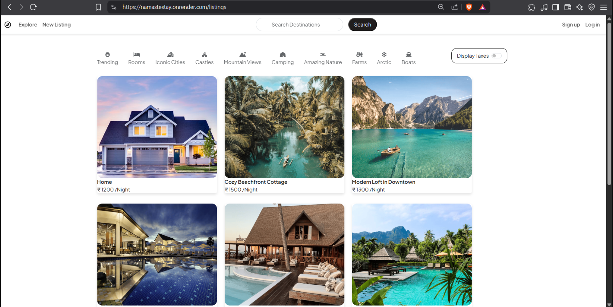
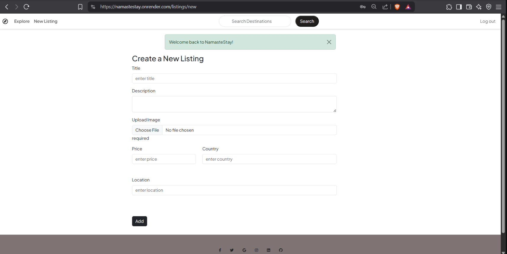
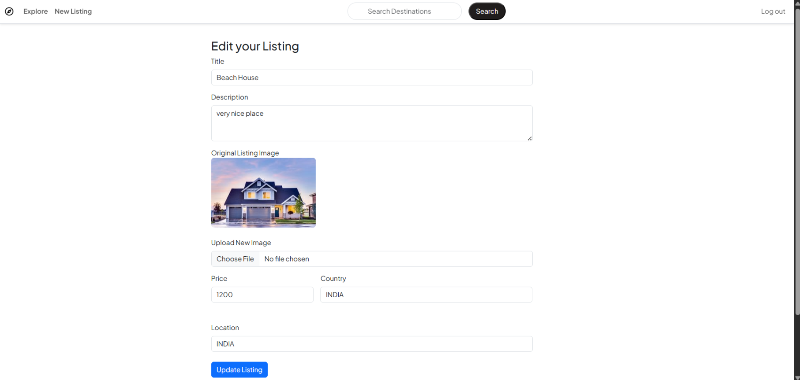
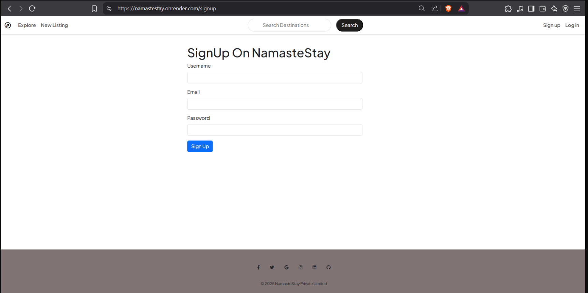

# 🏡 NamasteStay

### Full-Stack Accommodation Listing Platform

**NamasteStay** is a full-stack accommodation listing web application where users can explore stays, create and manage property listings with images, and add reviews.

The application is built using **Node.js, Express.js, MongoDB, Mongoose, EJS, Bootstrap, and Cloudinary**, following an **MVC architecture** with authentication, authorization, CRUD operations, validation, middleware, and cloud-based image management.

> **Project Focus:** Full-Stack Development • Backend Architecture • RESTful Routing • Authentication • CRUD • MongoDB • Cloudinary

---

## 🚀 Quick Start

### Prerequisites

- Node.js
- npm
- MongoDB / MongoDB Atlas
- Cloudinary account
- Git

### 1. Clone the Repository

```bash
git clone https://github.com/NitinSingh1982/NamasteStay.git
```

### 2. Navigate to the Project

```bash
cd NamasteStay
```

### 3. Install Dependencies

```bash
npm install
```

### 4. Configure Environment Variables

Create a `.env` file in the project root:

```env
ATLASDB_URL=your_mongodb_connection_string
SECRET=your_session_secret

CLOUD_NAME=your_cloudinary_cloud_name
CLOUD_API_KEY=your_cloudinary_api_key
CLOUD_API_SECRET=your_cloudinary_api_secret
```

> ⚠️ Never commit `.env` files or expose database credentials and API keys.

### 5. Run the Application

```bash
node app.js
```

The application will start on the local server configured in `app.js`.

---

## ✨ Features

- 🏠 Create, view, update, and delete accommodation listings
- 🖼️ Upload listing images using Cloudinary
- 🔐 User signup, login, and logout
- 🛡️ Authentication and authorization for protected operations
- ⭐ Add and manage reviews
- 👤 Restrict listing modifications to authorized owners
- ✅ Server-side validation
- 🚨 Centralized error handling
- 💬 Flash messages for user feedback
- 📱 Responsive UI using Bootstrap
- 🏗️ MVC-based project architecture

---

## 🛠️ Tech Stack

| Area | Technologies |
|---|---|
| **Backend** | Node.js, Express.js |
| **Frontend / Views** | EJS, Bootstrap, HTML5, CSS3, JavaScript |
| **Database** | MongoDB, Mongoose |
| **Authentication** | Passport.js, express-session |
| **Session Store** | connect-mongo |
| **Validation** | Joi |
| **Image Upload** | Multer, Cloudinary |
| **Architecture** | MVC |
| **Tools** | Git, GitHub, VS Code |

---

## 🏗️ Architecture

NamasteStay follows the **Model-View-Controller (MVC)** architecture.

```text
                    ┌──────────────────┐
                    │      USER        │
                    │     Browser      │
                    └────────┬─────────┘
                             │
                             ▼
                    ┌──────────────────┐
                    │      ROUTES      │
                    │  Express Router  │
                    └────────┬─────────┘
                             │
                             ▼
                    ┌──────────────────┐
                    │    MIDDLEWARE    │
                    │ Auth / Validate  │
                    └────────┬─────────┘
                             │
                             ▼
                    ┌──────────────────┐
                    │   CONTROLLERS    │
                    │  Business Logic  │
                    └───────┬───┬──────┘
                            │   │
                   ┌────────┘   └────────┐
                   ▼                     ▼
            ┌─────────────┐       ┌─────────────┐
            │    MODEL    │       │     VIEW    │
            │  Mongoose   │       │     EJS     │
            └──────┬──────┘       └─────────────┘
                   │
                   ▼
            ┌─────────────┐
            │   MongoDB   │
            └─────────────┘
```

---

## 📂 Project Structure

```text
NamasteStay/
│
├── controllers/       # Application/business logic
├── models/            # Mongoose database models
├── routes/            # Express route definitions
├── views/             # EJS templates and layouts
├── public/             # CSS and client-side JavaScript
├── utils/              # Utility/helper functions
├── init/               # Database initialization/seeding
│
├── app.js              # Main application entry point
├── middleware.js       # Custom middleware
├── cloudConfig.js      # Cloudinary configuration
├── schema.js           # Joi validation schemas
│
├── package.json
├── package-lock.json
└── .gitignore
```

---

## 🔐 Authentication & Authorization

NamasteStay uses authentication and authorization to protect user-specific operations.

```text
User
 │
 ▼
Signup / Login
 │
 ▼
Passport Authentication
 │
 ▼
Session
 │
 ▼
Authenticated Request
 │
 ▼
Authorization Check
 │
 ▼
Protected Operation
```

Listing ownership is checked before allowing users to modify or delete resources.

---

## ☁️ Cloudinary Image Upload

Listing images are handled using **Multer** and stored using **Cloudinary**.

```text
User Upload
     │
     ▼
   Multer
     │
     ▼
 Cloudinary
     │
     ▼
Image URL / Metadata
     │
     ▼
 MongoDB
```

This keeps image storage separate from the application server.

---

## 🗄️ Data Models

The application is organized around three primary resources:

```text
User
 │
 ├──────────────► Listings
 │
 └──────────────► Reviews

Listing
 │
 └──────────────► Reviews
```

### Main Models

- **User** — user authentication and account data
- **Listing** — accommodation/property information
- **Review** — ratings and user feedback

---

## 📚 Documentation

For complete technical details, see:

### 👉 [DOCUMENTATION.md](DOCUMENTATION.md)

The documentation covers:

- Application architecture
- MVC implementation
- Folder structure
- Route documentation
- Controllers
- Models and relationships
- Authentication flow
- Authorization
- Middleware
- Validation
- Cloudinary integration
- Database design
- CRUD operations
- Error handling
- Application flow
- Setup and environment variables
- Future improvements
- Interview discussion points

---


## 📸 Screenshots

### 1. Home / Listings


### 2. Create Listing


### 3. Edit Listing


### 4. Login / Signup


---

## 🚀 Future Improvements

- 🔎 Advanced search and filtering
- 📍 Map integration
- 📅 Booking and reservation system
- 💳 Payment gateway
- ❤️ Wishlist functionality
- 🔔 Notifications
- 📊 Admin dashboard
- 📱 Further mobile optimization
- ⚡ Performance optimization
- 🚀 Production deployment improvements

---

## 👨‍💻 Author

### Nitin Singh

**B.Tech — Computer Science & Engineering (AI & ML)**

Interested in:

- Full-Stack Development
- Backend Development
- Java & DSA
- Artificial Intelligence & Machine Learning

### GitHub

[**NitinSingh1982**](https://github.com/NitinSingh1982)

### Project Repository

[**NamasteStay**](https://github.com/NitinSingh1982/NamasteStay)

---

## ⭐ Project

If you find this project useful, consider giving the repository a ⭐.

> **Built to learn full-stack development by implementing a real-world web application architecture.**